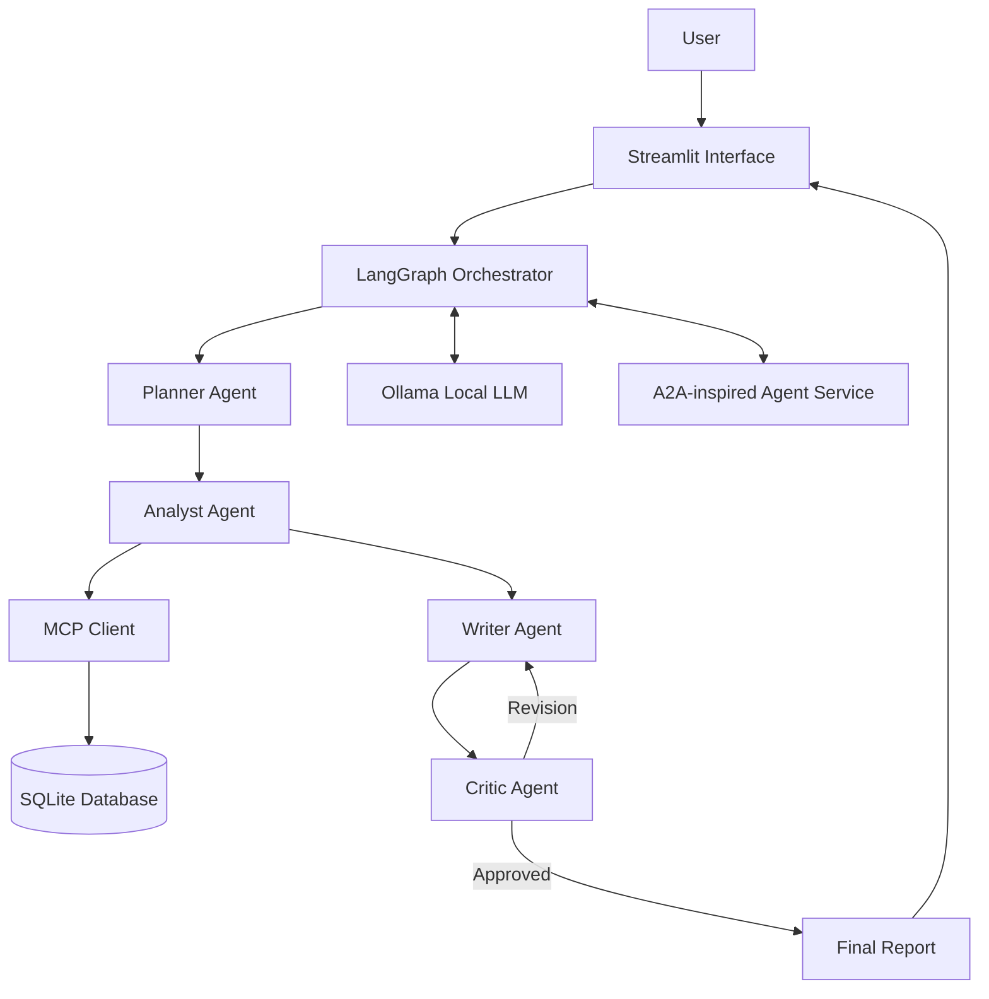

# ARGUS — Multi-Agent Intelligence Engine

**A locally runnable multi-agent AI system for business intelligence and analytical workflows.**

ARGUS brings together autonomous AI agents, database tools and agent-to-agent communication to turn natural-language business questions into SQL-backed analytical reports.

Built with **LangGraph, Model Context Protocol (MCP), A2A-style communication, Ollama and SQLite**.

---

## Overview

ARGUS demonstrates how multiple specialized AI agents can collaborate to answer business intelligence questions.

Instead of relying on a single LLM call, the system uses a coordinated workflow for planning, SQL analysis, report generation and result evaluation.

### Key capabilities

- **Multi-agent orchestration:** LangGraph coordinates planning, analysis, reporting and evaluation.
- **Tool integration:** An MCP server exposes database operations to the agent workflow.
- **Agent communication:** A lightweight custom A2A-inspired JSON-RPC prototype demonstrates communication between independent agent services.
- **Local LLM inference:** Ollama runs the language model locally.
- **Business intelligence:** Natural-language questions are translated into SQL-backed insights.
- **Evaluation workflow:** A critic agent reviews generated reports and can request revisions.
- **Benchmarking:** A benchmark script evaluates the system against a set of predefined questions.
- **Interactive dashboard:** Streamlit provides the user interface and execution inspector.

## Architecture



## Technology Stack

| Component | Technology |
|---|---|
| Agent orchestration | LangGraph |
| LLM inference | Ollama |
| Language model | Llama 3.2 3B |
| Tool integration | Model Context Protocol |
| Agent communication | Custom A2A-inspired JSON-RPC |
| Database | SQLite |
| User interface | Streamlit |
| Data analysis | SQL |
| Testing | Pytest |
| Benchmarking | Python |

## Project Structure

```text
ARGUS/
├── agents/
│   ├── graph.py
│   ├── llm.py
│   ├── mcp_client.py
│   ├── a2a_client.py
│   ├── a2a_server.py
│   └── run.py
├── bench/
│   └── run_bench.py
├── data/
│   ├── hr_attrition.csv
│   └── llm_models.csv
├── mcp_server/
│   ├── server.py
│   ├── seed_db.py
│   └── guard.py
├── scripts/
├── tests/
├── app.py
├── requirements.txt
├── .env.example
└── README.md
```

## Getting Started

### Prerequisites

- Python 3.11
- Git
- Ollama
- Approximately 16 GB RAM recommended for a comfortable local development experience with the selected model.

### 1. Clone the repository

```bash
git clone https://github.com/YOUR_USERNAME/ARGUS.git
cd ARGUS
```

### 2. Create a virtual environment

**Windows PowerShell:**

```powershell
python -m venv .venv
.venv\Scripts\activate
```

### 3. Install dependencies

```powershell
pip install -r requirements.txt
```

### 4. Configure environment variables

```powershell
Copy-Item .env.example .env
```

### 5. Download the local model

```powershell
ollama pull llama3.2:3b
```

Ensure Ollama is running.

### 6. Initialize the database

```powershell
python -m mcp_server.seed_db
```

### 7. Run the application

```powershell
streamlit run app.py
```

## Example Queries

Try asking ARGUS:

- Which department has the highest employee attrition, and is overtime associated with it?
- Which AI models have the highest total token costs?
- Which customer segments generate the most revenue?
- Which support ticket categories take the longest to resolve?

## Running Tests

```powershell
python -m pytest -q tests
```

## Running the CLI

```powershell
python -m agents.run "Which department has the highest attrition?"
```

## A2A Communication Demo

Start the agent service:

```powershell
uvicorn agents.a2a_server:app --port 9000
```

In another terminal:

```powershell
python -m agents.a2a_client "Top customer segment by revenue?"
```

The A2A component is a lightweight custom JSON-RPC prototype inspired by agent-to-agent communication patterns. It is not a claim of full official A2A protocol compliance.

## Benchmarking

Run the evaluation script:

```powershell
python -m bench.run_bench
```

The benchmark uses a predefined set of questions and expected answers to provide a basic indication of analytical performance.

It is intended as a demonstration and development aid, not a comprehensive scientific evaluation.

## Dataset Notes

ARGUS combines reference datasets and synthetic demonstration data.

- Employee attrition data: IBM HR Analytics sample dataset.
- LLM model metadata: model pricing and context information.
- Customer, product and order records: synthetic data.
- Token usage and support tickets: synthetic data generated for demonstration.

**Important:** The token usage and business records are not real company billing or customer records. Reported financial values are based on the local demonstration database.

## Design Considerations and Limitations

ARGUS is an educational and portfolio demonstration of an industry-inspired multi-agent architecture.

- SQL validation uses basic safeguards and is not a production-grade security boundary.
- LLM-generated analysis and evaluation can make mistakes.
- The custom A2A-inspired service is a minimal prototype.
- Benchmark results are indicative, not a guarantee of analytical accuracy.
- Local inference performance depends on available CPU, memory and model configuration.

The project is not intended for production deployment or use with sensitive business data without additional engineering, security and validation.

## Future Improvements

- Stronger SQL validation and query policies.
- More comprehensive evaluation datasets and metrics.
- Official A2A protocol integration.
- Persistent agent memory.
- Distributed model inference.
- Deployment with a hosted inference provider.

---

## Author

**ARGUS — Multi-Agent Intelligence Engine**

Built as an AI engineering portfolio project exploring multi-agent orchestration, tool integration, local LLM inference and business intelligence.
